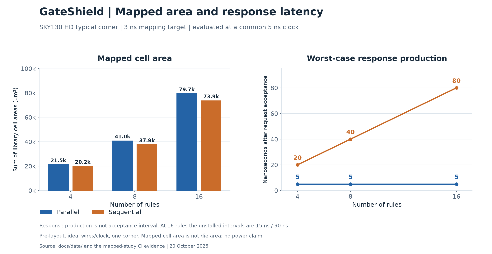

# GateShield

A small packet-header policy engine for studying comparator sharing, policy correctness, and area/latency tradeoffs.

## Current milestone

Implemented: policy specification, independent Python model, parallel matching core, and registered parallel and sequential engines with programmable rule storage, request capture, response backpressure, and configuration exclusion. Python-generated vectors drive the core testbench and transaction scoreboards. A common corpus checks that both engines return identical ordered decisions despite different latencies.

Also implemented: a library-mapped area and constrained-timing study (sky130_fd_sc_hd, Yosys/ABC, OpenSTA) and gate-level replay of the mapped netlists. See `docs/findings.md` for results, the diagnosis of the sequential engine's original overhead, limitations, and design decisions.

The constant-slice access fix removes the earlier generic-synthesis overhead. See [findings](docs/findings.md) for two further measurement corrections: response latency differs from acceptance interval, and ABC/OpenSTA require different capacitance units. Historical supplied mapping data is archived; corrected mapping results are identified separately.

The corrected-load [CI run](https://github.com/jrmywm/GateShield/actions/runs/39375335391) passed all 12 mapped-netlist replays. At the common 5 ns clock, all six 3 ns-target implementations pass setup. Sequential saves 6–8% mapped cell area but takes 4–16 cycles in the worst case versus one cycle for parallel. See the [generated common-clock summary](docs/data/mapped_summary_corrected.md). No design met the 3 ns mapping target itself.

Next: formal harness and application write-up. Generic Yosys cell counts are not standard-cell area. Packet parsing and forwarding integration remain outside this project.

Run from this directory with Python 3.10 or newer:

```text
python -m unittest discover -s tests -v
python scripts/check_rtl.py
python scripts/check_engine.py
python scripts/check_synthesis.py
```

Optional mapped study, with OpenSTA and the SKY130 typical Liberty installed:

```sh
export STA=/path/to/sta
export GATESHIELD_LIBERTY=/path/to/sky130hd_tt.lib.gz
python scripts/check_mapping.py --eval-period 5
python scripts/check_gate_level.py
```

On PowerShell set `$env:STA` and `$env:GATESHIELD_LIBERTY` instead. The separate **Mapped area, timing and replay** CI workflow builds pinned timing tools and performs these steps on Linux. It checks 12 mapped netlists: two architectures × three rule counts × two mapping targets. Results are valid only after the corresponding workflow completes successfully.

The simulation commands require `iverilog` and `vvp` on PATH. The synthesis command requires `yosys`. Intermediate files go under the ignored `build/` directory. Missing tools produce an explicit failure, never a passing RTL result. Both simulation scripts accept `--generate-only` for generating vectors without running hardware simulation.

GitHub Actions runs Python tests, Icarus core and both registered-engine simulations, cross-architecture decision replay, and generic Yosys synthesis checks on pushes and pull requests. It uploads CSV reports, synthesis statistics, and logs as `gateshield-comparison-reports`. A workflow definition alone is not evidence that the RTL has passed: check the completed run for the commit being reviewed.

The original core passed 52,544 differential cases in CI. The engine suite targets 1, 4, 8, and 16 rules with directed and seeded mixed-cycle traffic. It checks policy decisions against the independent Python evaluator and accounts for accepted, completed, and reset-canceled transactions. The checker also verifies handshakes, response production, and payload stability during receiver stalls. Both engines replay the same completed-transaction corpus; later arbitrary-cycle fuzz can produce different acceptance streams because their readiness differs. These are simulation checks, not formal proofs.

## Engine interface and timing

Both engines implement one outstanding request. The parallel engine (`rtl/gateshield_parallel.v`) registers the decision on the rising edge after acceptance. With no stalls or configuration changes, its initiation interval is three cycles. The sequential engine (`rtl/gateshield_sequential.v`) checks one rule each cycle and stops at the first match. Its production latency is k+1 cycles for a match at zero-based index k, or N_RULES cycles for no match. Its unstalled initiation interval is latency+2. Unsupported protocols take the full no-match scan. These are clock counts, not frequency measurements.

Assert `cfg_mode` and hold it until `cfg_active` is observed. This stops new requests immediately while existing work drains. Write one whole packed rule when `cfg_valid && cfg_ready`. An index outside the table is rejected. Deassert `cfg_mode` to leave configuration; requests can resume after the next rising edge. Reset clears rules and cancels pending work.

## Comparison reports

- `build/latency_comparison.csv`: observed response production cycles for the common synthetic replay corpus. Receiver stalls are excluded from production latency. Workload averages do not represent real network traffic.
- `build/mapped_comparison.csv`: mapped cell area, minimum-period estimates, direct common-clock slack, and separately named response-latency and acceptance-interval fields. Mapping and gate-level CI artifacts include the source/library metadata and netlists. Pre-layout, ideal wires, one typical corner; not signoff.
- `build/generic_synthesis_comparison.csv`: flattened, pre-ABC Yosys generic cell counts and register-bit counts, with tool version. Both designs use the same rule storage format and flow. Generic cells have different implementation costs; percentages are not standard-cell area savings.

Rule-selection multiplexers and the scan counter count toward the sequential implementation. Policy storage counts toward both. Response timing depends on scan depth; this prototype makes no policy-confidentiality or constant-time claim.

Read `docs/specification.md` before changing behavior and `docs/roadmap.md` for the remaining milestones.

## Research discipline

Comparator sharing and first-match filtering are established techniques. In this Yosys flow the original variable-offset rule access produced expensive shift/mux networks; constant-slice decoding improved both implementations. This is a tool/implementation observation, not a universal restriction on variable part-selects. Compare identical policy/storage/interface semantics, and distinguish generic counts, mapped cell area, response latency, acceptance interval, and physical timing. No power saving is established.

## Figures

[Figure guide](docs/figures/README.md) includes PNG/SVG exports and their provenance. Regenerate with `python scripts/plot_results.py` after installing `scripts/requirements-figures.txt`. The original v0.3 figures are archived under `docs/figures/archive_v0.3/`.


